# BBone to Bones

[](https://www.blender.org)
[](LICENSE)
[](tests/run.py)
[](tests/run.py)
[](tests/run.py)
[](tests/run.py)
[](https://github.com/PieroFra/bbone-to-bones/releases)

Converts Blender Bendy Bones (B-Bones) into standard deform bone chains, with automatic weight transfer, animation baking, and export presets for **Unity**, **Unreal Engine**, and **Godot**.

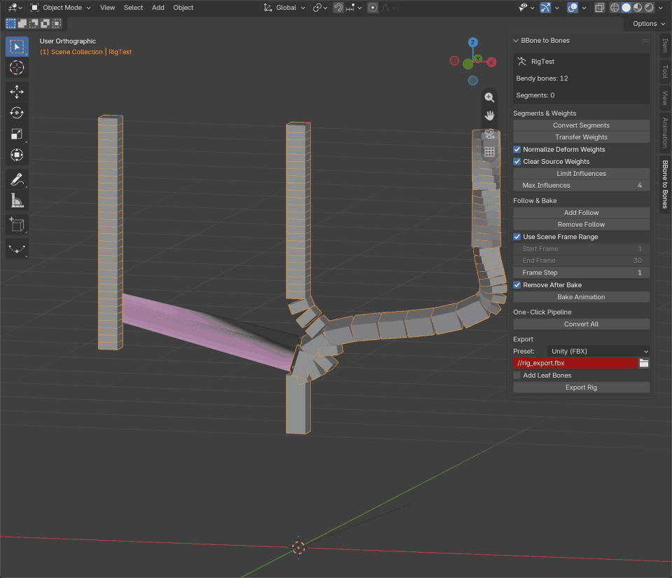

[Watch 1080p 60fps MP4 showcase](https://raw.githubusercontent.com/PieroFra/bbone-to-bones/main/docs/bbone_showcase_1080p.mp4)

## Quick Install

1. Download [bbone_to_bones-0.2.1.zip](https://github.com/PieroFra/bbone-to-bones/releases/download/v0.2.1/bbone_to_bones-0.2.1.zip) from the [v0.2.1 Release](https://github.com/PieroFra/bbone-to-bones/releases/tag/v0.2.1).
2. In Blender: `Edit > Preferences > Add-ons > Install from Disk` and select the zip.
3. Enable **BBone to Bones** and open the `BBone to Bones` tab in the 3D Viewport Sidebar.

## Key Features

1. **Non-destructive `Revert to BBones`** (`btob.revert_to_bbones`): deletes generated segment bones and transfers skin weights back onto the original bendy bones at any time (verified in [`tests/run.py`](tests/run.py)).
2. **Curved joint boundary blending**: blends the last segment endpoint onto the connected child bone's first segment ([`core/weights.py`](core/weights.py)), keeping posed and baked vertex positions within `< 0.001 m` of the source B-Bone deformation (`9.90e-07 m` max delta in [`tests/run.py`](tests/run.py)).
3. **One-click deform-only influence cap** (`btob.limit_influences`): caps per-vertex weights on deform bones only and preserves non-deform vertex groups (`ClothPin`, masks, physics pins) in one click, without having to switch Blender's native `Limit Total` subset to `Pose Bone Deform` manually ([`tests/run.py`](tests/run.py)).
4. **Multi-Action / NLA Bake & Linear Skin (LBS)**:
   - **All Actions** (`bake_all_actions`): bakes and exports every armature Action and NLA strip, with full support for Blender 4.2 Actions and Blender 5.x Slotted Actions ([`core/bake.py`](core/bake.py)).
   - **Linear Skin (LBS)** (`disable_preserve_volume`): turns off Dual Quaternion `Preserve Volume` on Armature modifiers at export so Blender matches the Linear Blend Skinning used by game engines ([`core/export.py`](core/export.py)).
5. **5 Engine Export Presets**:
   - Presets: `UNITY` (FBX), `UNITY_GLTF` (`.glb`), `UNREAL` (FBX), `UNREAL_GLTF` (`.glb`), and `GODOT` (`.glb`), exporting deform bones only (`add_leaf_bones=False` by default, `use_connect=False` segment chains).

## Usage (3D Viewport > Sidebar > BBone to Bones)

1. **Convert Segments** (`btob.convert_segments`) - replaces each bendy bone with a chain of `<name>_seg_00..XX` deform bones (or only the current selection when **Selected Bones Only** is enabled).
2. **Transfer Weights** (`btob.transfer_weights`) - splits and normalizes skin weights from the bendy bones onto the segment chains with curved joint boundary blending.
3. **Add Follow / Bake Animation** (`btob.add_constraints`, `btob.bake_animation`) - binds segment bones to the B-Bone curve and bakes keyframes across the active Action or **All Actions**.
4. **Export Rig** (`btob.export_rig`) - caps influences, applies **Linear Skin (LBS)**, and exports `.fbx` or `.glb` using the chosen engine preset.

 Or click **Convert All** (`btob.convert_all`) to run steps 1-3 in a single operation, and **Revert to BBones** (`btob.revert_to_bbones`) whenever you want to return to the original B-Bone rig.

## Screenshots

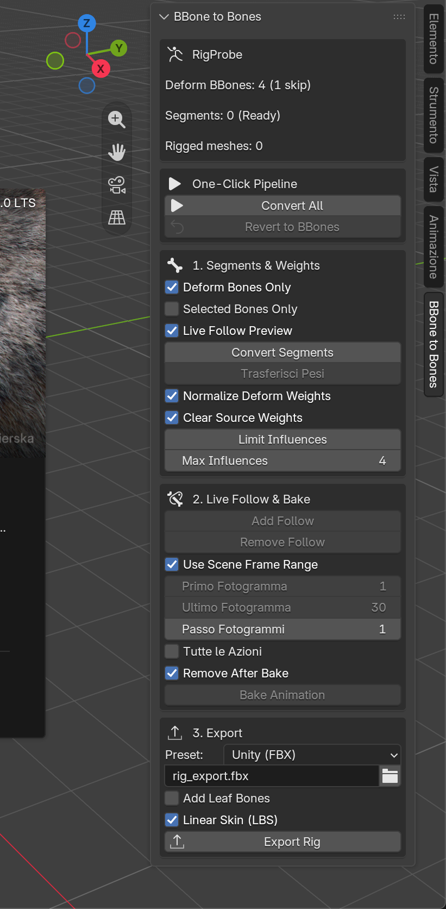

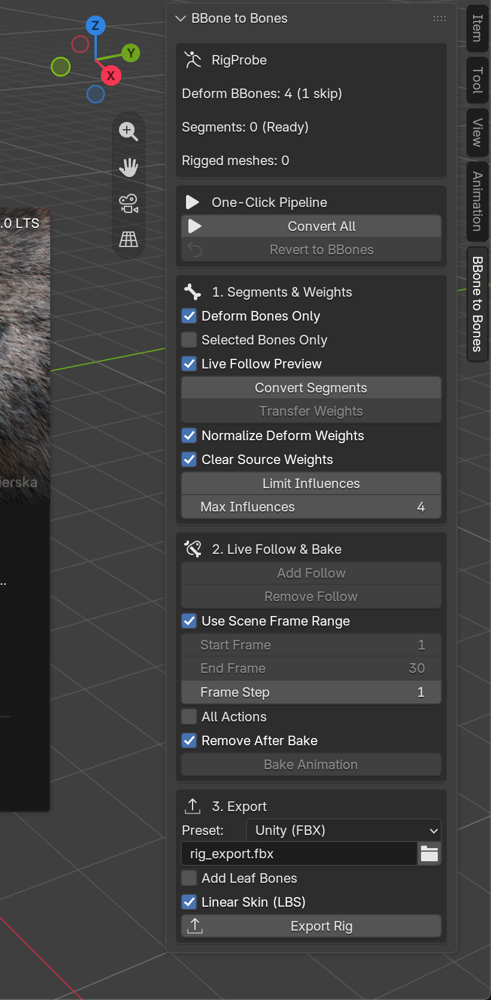

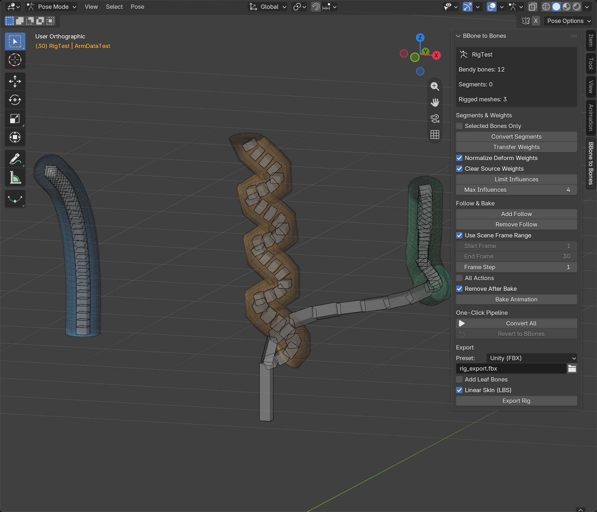

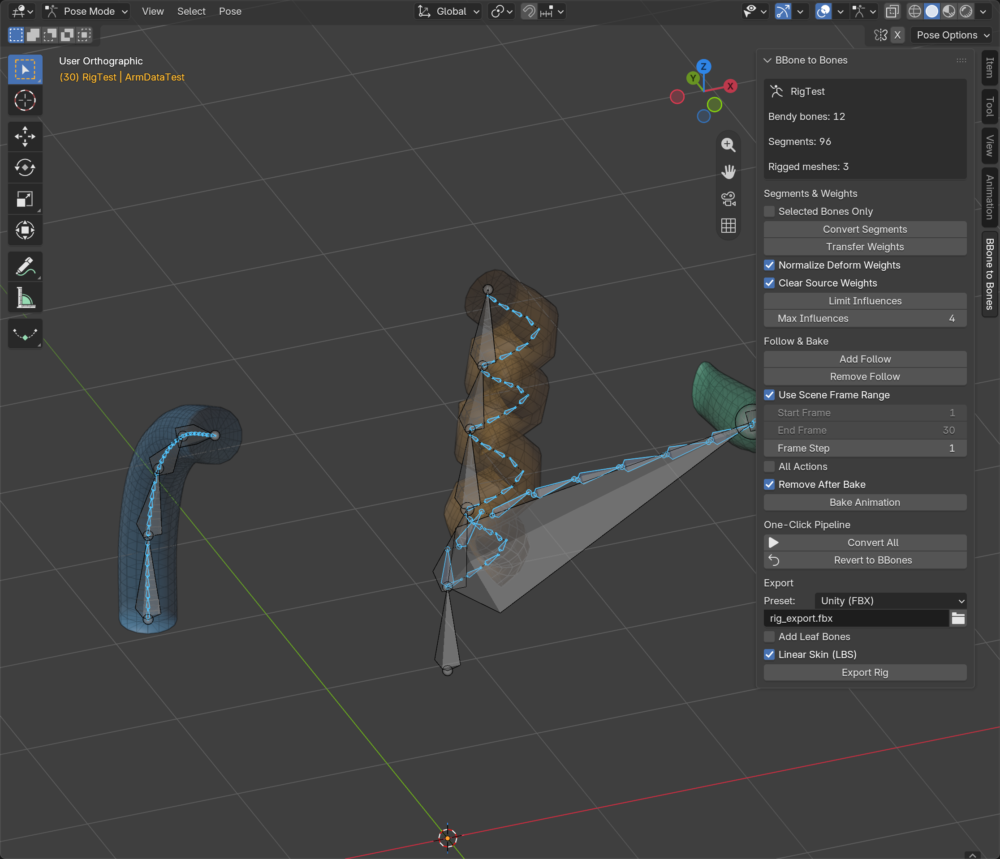

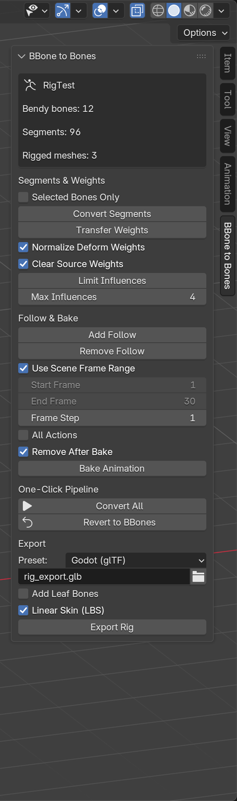

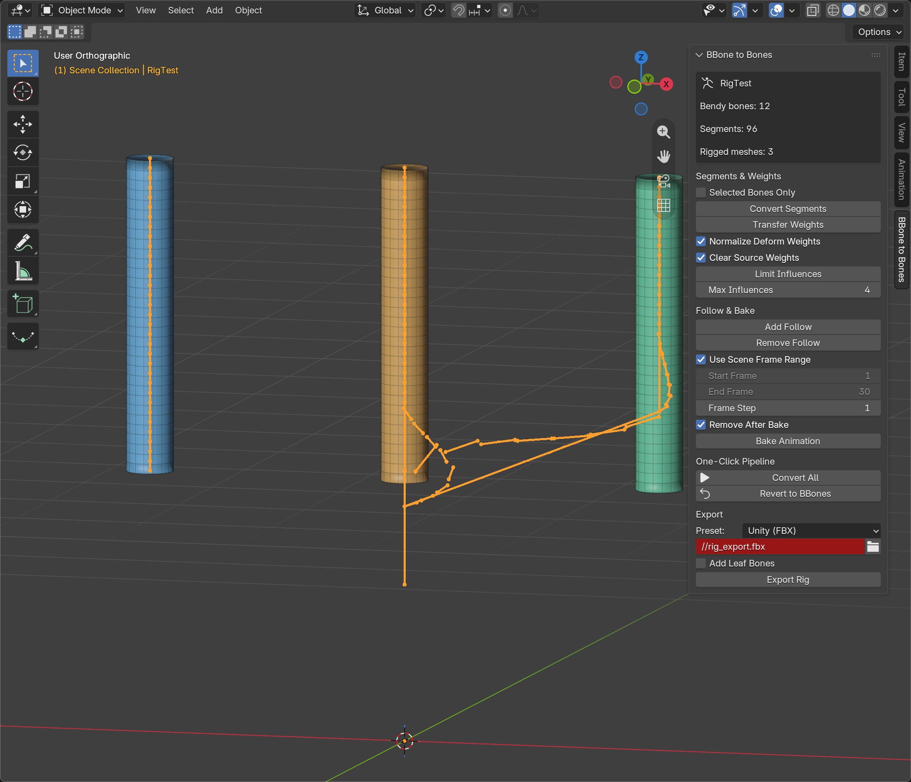

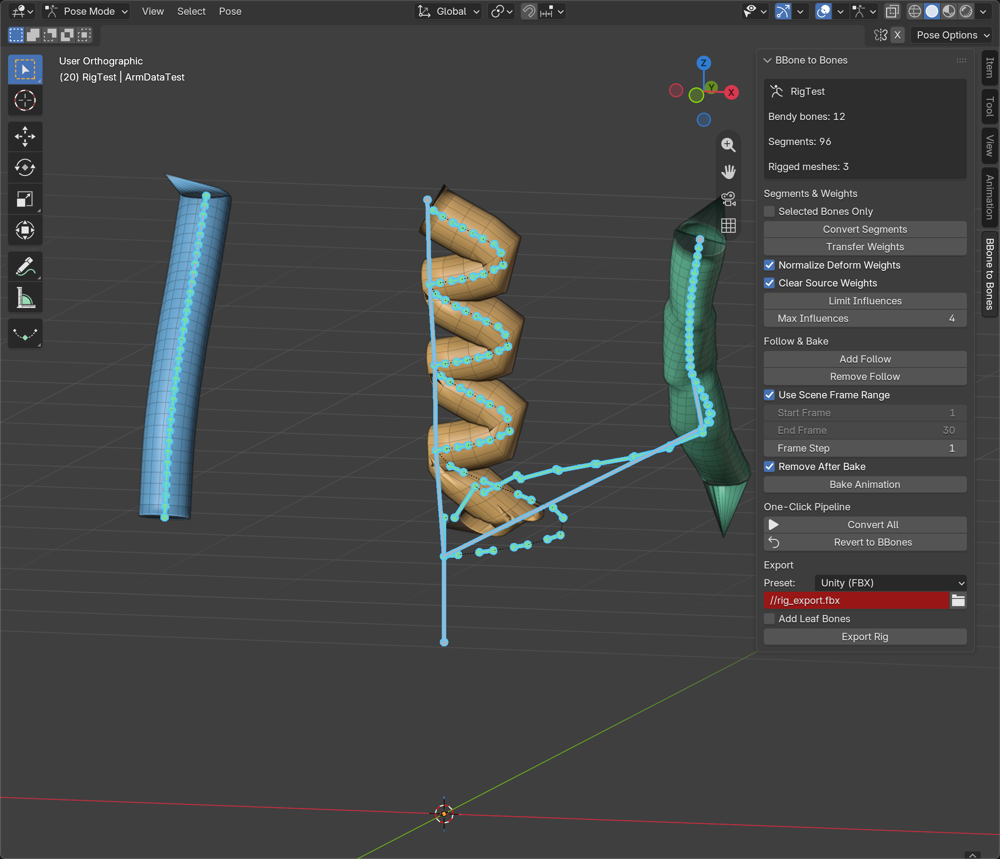

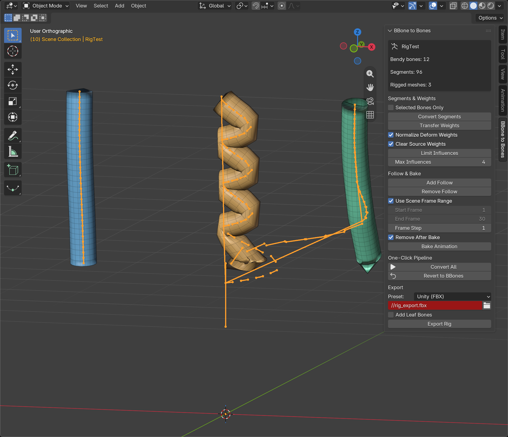

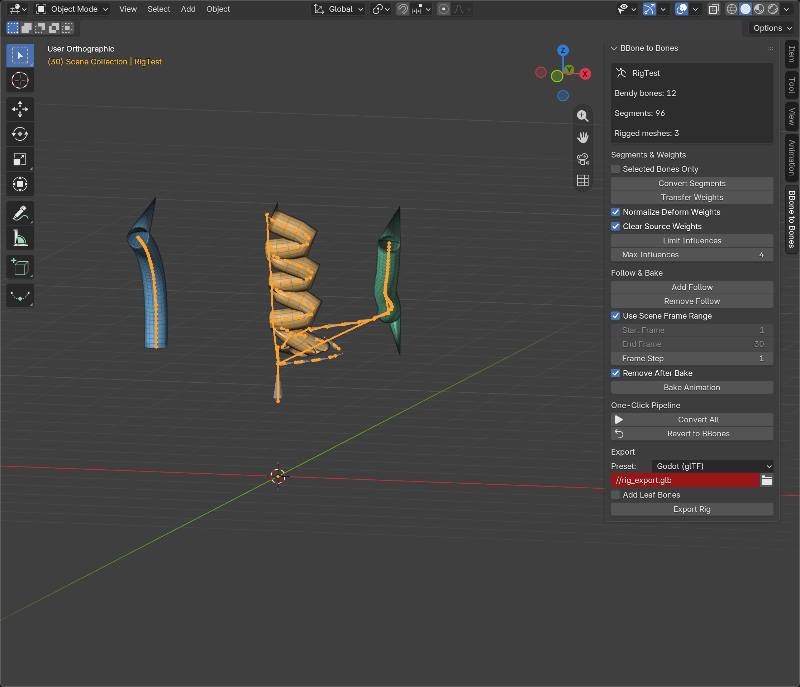


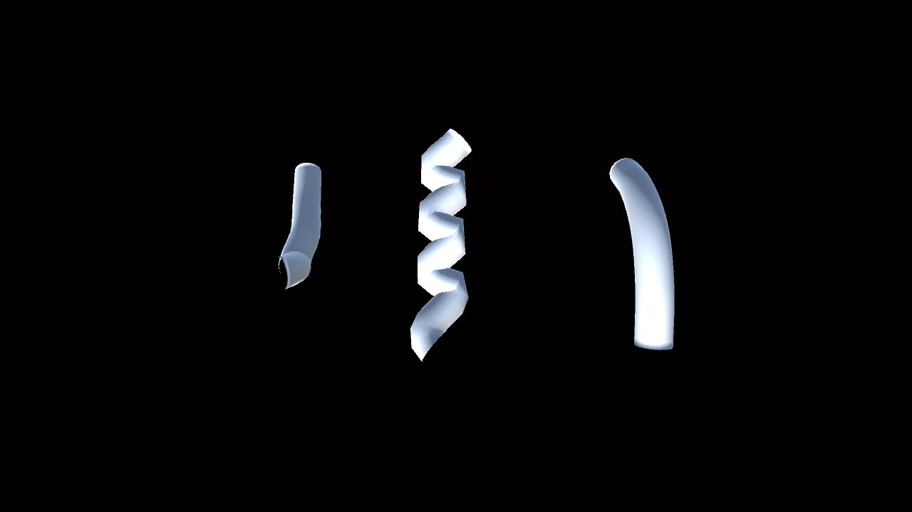

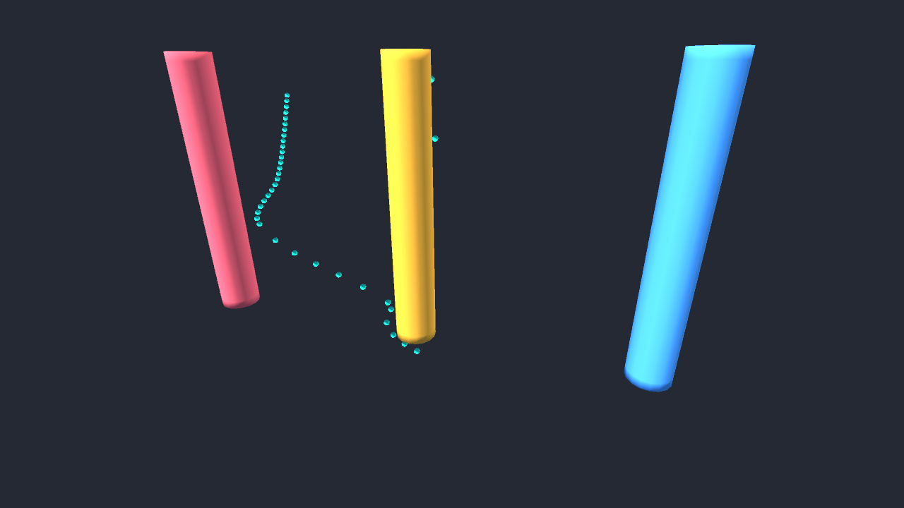

## Tested Versions & Engine Verification

- **Blender**: `4.2.23 LTS` and `5.2.3 LTS` on Ubuntu and Windows ([`.github/workflows/ci.yml`](.github/workflows/ci.yml)), plus `5.2.0 LTS` locally.
- **Godot Engine**: `4.7.2-stable` (latest stable) and `4.3-stable` (headless `.glb` import, skeleton, skin, and animation verification).
- **Unity**: `6000.6.6f1` (`-batchmode` `.fbx` prefab, `SkinnedMeshRenderer`, 96 segment bones, and `AnimationClip` verification).
- **Unreal Engine**: `UNREAL` (`.fbx`) and `UNREAL_GLTF` (`.glb`) presets verified via round-trip reimport in [`tests/run.py`](tests/run.py) and FBX/glTF inspection.

## Tests

Run the deterministic headless test suite (builds its own multi-chain B-Bone fixture in memory):

```sh
blender -b -noaudio --python tests/run.py
```

## Packaging

Building the release archives is a local step: the add-on folder is staged and
zipped, the checksum and the file manifest are written next to it, and the
result is validated with a clean install in an isolated Blender profile.

Builds `dist/bbone_to_bones-0.2.1.zip` alongside its `.sha256` checksum and file manifest, and validates clean installation in an isolated Blender profile. The images in `docs/screenshots/` are documentation only and do not enter the zip.

## Part of the Rigging Suite

BBone to Bones is fully **standalone** with **zero dependencies**: it keeps its own `BBone to Bones` Sidebar tab. When installed alongside **CTRL_DEF** or **A.C.T.D.** the panel adds quick handoff buttons (`Generate CTRL`, `Bind CTRL to DEF`, `Apply ACTD`), so all three rigging tools share one workflow with no extra setup.

If a rigging or export step slows you down, open an issue with the workflow you want automated next.

Developed with AI assistance under the author's direction, review, and responsibility.

## Known limitations / Compatibility

This addon converts Bendy Bones to standard deform bone chains, supports weight transfer, animation bake, and export for Unity, Unreal, and Godot. The minimum required Blender version is 4.2.0. Tested environments include Blender 4.2.23 LTS and 5.2.3 LTS on Ubuntu/Windows (CI), and 5.2.0 LTS locally. Note that 4.2 compatibility is only validated via CI, not locally.

- Export targets game engines (FBX/glTF) using Linear Blend Skinning.
- Conversion creates chains with `use_connect=False`.
- Revert to BBones requires the generated segments to exist.
- The B-Bone curve is approximated using finite segments (pose tolerance < 0.001 m).

## Credits / Support / Report a bug

Report bugs or suggest features via GitHub Issues: https://github.com/PieroFra/bbone-to-bones/issues. This project utilizes AI assistance but is developed under the direction, review, and full responsibility of the author. Please open issues detailing the complete workflow to facilitate automation.
