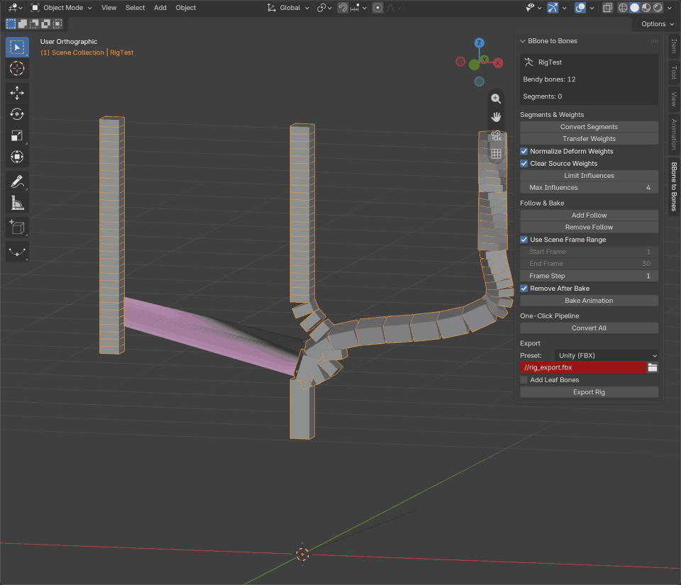

# PROMO.md - BBone to Bones v0.1.0

Ready-to-use promo texts for the v0.1.0 release. Zero em-dashes by policy.

---

## Blender Extensions

### Short description

Converts Blender bendy bones into standard, game-ready bone chains for Unity, Unreal and Godot.

### Release notes v0.1.0

Initial public release.

- Converts bendy bones into standard bone chains with curved joint boundary blending, deviation under 0.001 m against the original curve.
- Limits each generated chain to deform-only influence so game engines read clean weights.
- Bakes animation across multiple actions, including Slotted Actions, into the bone chain.
- Non-destructive workflow: Revert to BBones restores the original rig at any time.
- Rigging Suite panel auto-tab plus 5 export presets: UNITY, UNITY_GLTF, UNREAL, UNREAL_GLTF, GODOT.
- Minimum Blender version: 4.2.

---

## Blender Artists

**Title:** [Free Add-on] BBone to Bones - Convert Bendy Bones to Game-Ready Chains (Unity, Unreal, Godot)

**Body:**

Hi everyone. Bendy bones look great in Blender, but game engines do not understand them. BBone to Bones converts a bendy bone chain into a chain of standard bones that matches the original curve, ready for export.

What it does, honestly and directly:

1. **Curved joint boundary blending.** Each generated bone keeps the original bbone curve shape, with joint deviations measured under 0.001 m on the test rigs.
2. **Deform-only influence cap.** The generated chains are capped to deform-only influence, so no stray controls pollute your weight transfers in engine.
3. **Multi-action and Slotted Action baking.** Animation on the bbone rig is baked onto the new chain, across multiple actions, including the new Slotted Actions in Blender 4.4+.
4. **Non-destructive Revert to BBones.** The original bendy bone rig is never destroyed. One click restores it, so you can iterate and still ship the standard chain.
5. **Rigging Suite auto-tab and 5 export presets.** The panel lands in its own auto-tab, with presets for UNITY, UNITY_GLTF, UNREAL, UNREAL_GLTF and GODOT.

It is free and open source. Repo: https://github.com/PieroFra/bbone-to-bones

If you hit a bug or want a feature, the issue tracker is the fastest path: https://github.com/PieroFra/bbone-to-bones/issues

Feedback from riggers and indies doing Unity/Unreal/Godot pipelines is very welcome.

---

## Reddit (r/blender)

**Title:**

I made a free add-on that converts Blender bendy bones into game-ready bone chains (Unity, Unreal, Godot)

**Body:** (no links of any kind in the body)

Bendy bones are great for animating in Blender, but the moment you export to Unity, Unreal or Godot they turn into a pile of straight bones that no longer match the shape you animated. I hit that wall enough times that I wrote an add-on to fix it.

BBone to Bones converts a bendy bone chain into a chain of standard bones whose joint positions follow the original curve, with deviation measured under 0.001 m on my test rigs. The generated chain is capped to deform-only influence so engine weights stay clean. It bakes your animation onto the new chain across multiple actions, including the newer Slotted Actions. The original bendy bone rig is preserved: one click reverts to it, so nothing about the conversion is destructive. There are also built-in export presets for UNITY, UNITY_GLTF, UNREAL, UNREAL_GLTF and GODOT.

Testing focus: rigs with several stacked bbone chains, animation-heavy characters, and engines that are picky about bone naming. If someone here has a gnarly rig and wants to stress-test it, that feedback would be gold.

GitHub repo and issue tracker are in my comment below.

**First comment (posted by me, right after submitting):**

Repo here: https://github.com/PieroFra/bbone-to-bones

Issue tracker for bugs and feature requests: https://github.com/PieroFra/bbone-to-bones/issues

Happy to add more export presets if the common ones miss something. Ask anything about the conversion pipeline.
